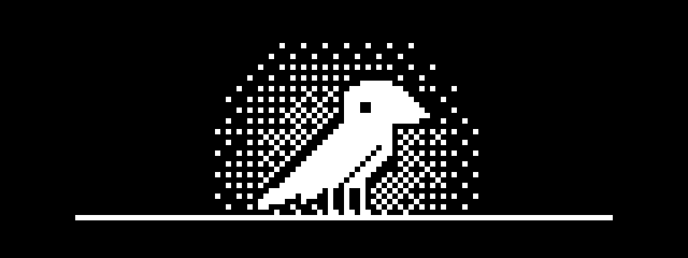

# Yata



Um notch vivo no topo da tela do Windows, logo abaixo da câmera: mostra o que está tocando, a hora, seus lembretes, e sai do caminho quando não é necessário.

O nome vem de **Yatagarasu** (八咫烏), o corvo mensageiro e guia da mitologia japonesa — parente dos corvos Huginn e Muninn, que voam pelo mundo e voltam contando o que viram. É isso que o Yata faz: fica lá em cima e te traz as notícias.

Projeto de código aberto, sem conta e sem telemetria.

**Dados locais:** tarefas, registro de água e caminhos da prateleira ficam em `%LOCALAPPDATA%\Yata\data.json`.

**Acesso à rede:** só o que você liga, e nada sobre o PC é enviado:
- busca de letras no [LRCLIB](https://lrclib.net) (serviço aberto e gratuito), enviando apenas artista, título e duração da música. As letras ficam em cache em `%LOCALAPPDATA%\Yata\lyrics`. Pode ser desligada nas configurações.
- aviso de versão nova: **desligado por padrão**. Se ligado, consulta uma vez por dia a [página pública de versões](https://github.com/akaneni/yata/releases) do GitHub. A instalação continua manual.
- **tempo** no [Open-Meteo](https://open-meteo.com) (aberto, sem conta nem chave), só se você ligar: envia as coordenadas da cidade escolhida, arredondadas para ~1 km. A busca da cidade envia só o nome digitado.
- **Google Agenda**, só se você conectar sua conta: leitura das agendas e dos eventos de hoje e amanhã, direto entre o PC e o Google. O acesso fica cifrado com DPAPI em `%LOCALAPPDATA%\Yata\google.dat` e os eventos ficam só na memória. Detalhes em [PRIVACY.md](PRIVACY.md).

## Identidade

- **Minimalista e monocromático**: notch preto, texto branco; a cor da capa da música é o único acento.
- **O Yata**: um corvo em pixel art 1-bit (16×14), branco sobre o preto do notch. Desenhado à mão em `Views/RavenSprite.cs`; o ícone do app é gerado a partir do mesmo sprite (`tools/make-icon.ps1`).
- **Repertório**: pisca, olha para trás, se ajeita e, de vez em quando, olha para cima, estica a asa ou dá um pulinho; dorme respirando devagar; grasna quando traz um lembrete, se sacode quando a meta de água é batida e chega com uma carta quando traz as novidades.
- **Artes maiores** (README e instalador): o mesmo traço no dobro da resolução e com três pernas, como o Yatagarasu do mito, diante de um sol pontilhado em 1-bit. Geradas com o PhotoCraft da suíte ArtCraft (`tools/make-art.ps1`); o GIF abaixo sai do próprio sprite e é codificado no EffectCraft (`tools/make-gif.ps1`).


## Funcionalidades (v0.1)

- **Notch compacto**: relógio quando nada toca; capa, título e equalizador animado quando há mídia.
- **Expande ao passar o mouse** com animação de mola; recolhe ao sair.
- **Player de mídia** de qualquer app que use os controles de mídia do Windows (Spotify, YouTube no navegador, etc.): capa, título, artista, barra de progresso com busca, anterior/play/próxima. Com vários players abertos, segue o que está **tocando de fato**.
- **Letras sincronizadas**: o notch se divide em dois (player + letra rolando), a linha atual fica em destaque e clicar numa linha pula para ela. No modo compacto aparece a linha sendo cantada.
- **Avisos do sistema** no notch compacto: volume/mudo, brilho, carregador conectado/desconectado, bateria baixa (20% e 10%), troca de saída de áudio (fone/caixa), Caps Lock, troca de idioma do teclado e conexão de rede. O teclado é lido por consulta de estado, **sem hook** — o app nunca vê o que é digitado.
- **Câmera e microfone em uso**: ponto laranja (microfone) ou verde (câmera) no notch fechado e o nome dos apps no notch aberto. O microfone vem das sessões de áudio do Windows (Core Audio). A câmera depende do registro que o Windows mantinha até a versão 25H2; no Windows 11 26H2 esse dado passou a exigir administrador, então lá só o microfone é detectado.
- **Atalho Ctrl+Alt+Y** abre e fecha o notch de qualquer lugar (`RegisterHotKey`: o Windows avisa só essa combinação).
- **Vários monitores**: escolha nas configurações em qual tela o notch fica; respeita a escala de cada tela.
- **Abas no notch aberto**: Mídia, Agenda, Foco, Água, Tarefas e Prateleira.
- **Agenda (Google)**: conecte com sua conta Google (OAuth, só leitura) e escolha quais agendas aparecem. A aba mostra hoje e amanhã, destaca o evento em andamento e tem o botão **Entrar** para chamadas do Meet, Zoom e Teams. O notch fechado mostra "Daily em 8 min" nos 15 minutos antes, e chega um aviso (com som) alguns minutos antes, configurável, e outro quando o evento começa. Convites recusados não aparecem. Para cadastrar o app no Google, veja [docs/google-calendar.md](docs/google-calendar.md).
- **Tempo** (desligado por padrão): você escolhe a cidade pelo nome ou, se preferir, com uma leitura única da localização do Windows (arredondada para ~1 km na hora, nunca guardada com precisão). Nada de geolocalização por IP. Ícones em pixel art 1-bit no estilo do Yata. O notch fechado mostra ícone e temperatura ao lado do relógio; aberto sem música, mostra condição, máxima/mínima e a chuva prevista. Chega um aviso quando a chance de chuva passa de 60% nas próximas 2 horas. Dados do tempo: [Open-Meteo.com](https://open-meteo.com) (CC BY 4.0).
- **Foco (Pomodoro)**: 25 min de foco / 5 min de pausa, pausa longa de 15 min a cada 4 sessões, aviso sonoro ao fim de cada fase e contagem no notch compacto. Controles explícitos por estado: **Iniciar**, **Pausar**, **Continuar**, **Parar** e **Pular pausa**; pausado, o anel apaga e o tempo pisca suave (e o notch compacto mostra ⏸).
- **Água**: meta diária, botão +250 ml, gráfico dos últimos 7 dias e lembrete de hora em hora (8h–22h) enquanto a meta não é batida.
- **Tarefas**: lista com marcar/remover; um horário no fim do texto ("Reunião 15:30") vira lembrete. O notch só aceita foco de teclado enquanto você digita e devolve o foco à janela anterior ao terminar.
- **Prateleira de arquivos**: arraste arquivos ou pastas até o notch para guardar e arraste de volta para qualquer app; clique duplo abre. Guarda só o caminho (nada é copiado) e itens apagados/movidos somem sozinhos. Imagens ganham miniatura.
- **O Yata (companheiro)**, a partir do tempo desde o último uso de mouse/teclado (`GetLastInputInfo` — só o horário, nunca o conteúdo):
  - **Modo ambiente** (2 min parado, nada tocando): o relógio dá lugar ao Yata pousado, que pisca, olha em volta e se ajeita; aos 10 min ele cochila.
  - **Com música tocando** e você longe: ele toma o lugar do equalizador e balança a cabeça.
  - **"Enquanto você esteve fora"**: ao voltar, o Yata chega voando com uma carta e os avisos que você perdeu (lembretes, água, bateria, foco pausado).
  - **Mensageiro**: lembretes (tarefas, água, foco, versão nova) chegam com o Yata grasnando no lugar do ícone; pequenas vitórias ganham comemoração (voo ao fim do foco, sacudida na meta de água).
  - **Pausa automática do foco** após 5 min longe (devolvendo o tempo não acompanhado), exceto se houver mídia tocando.
  - **Demonstração** pelo menu da bandeja (ou `Yata.exe --demo`) para ver todos os estados em ~30 s.
- **Configurações** (engrenagem no notch, menu ou clique duplo na bandeja): iniciar com o Windows, esconder em tela cheia, demora para abrir, cor da capa ou preto e branco, letras liga/desliga, cada tipo de aviso, tempos do Pomodoro, meta e lembretes de água, e o comportamento do Yata. Tudo aplica na hora.
- Lembretes que chegam com o notch aberto ou em tela cheia esperam e aparecem depois, em vez de serem perdidos.
- **Some em tela cheia** (vídeos, jogos, apresentações).
- Não rouba o foco, não aparece no Alt+Tab nem na barra de tarefas. Sair pelo ícone na bandeja.

## Instalar

Baixe `Yata-Setup-x.y.z.exe` em [Releases](https://github.com/akaneni/yata/releases) (~6 MB). O instalador:

- instala só para o seu usuário, sem pedir administrador;
- se faltar o **.NET 10 Desktop Runtime**, baixa direto da Microsoft e instala (essa etapa pede permissão de administrador);
- oferece iniciar com o Windows e atalho na área de trabalho;
- na desinstalação, remove o app e a inicialização automática, mas **mantém seus dados** em `%LOCALAPPDATA%\Yata`.

Cada release traz um `SHA256SUMS.txt` para conferir o arquivo baixado. O instalador ainda não é assinado digitalmente, então o Windows SmartScreen pode avisar na primeira execução.

## Requisitos

- Windows 10 (2004+) ou 11, x64
- [.NET 10 SDK](https://dotnet.microsoft.com/download) para compilar

## Compilar e rodar

```powershell
dotnet run --project src/Yata
```

A agenda do Google precisa de um cliente OAuth próprio, que não fica no repositório. Sem ele, o resto do app funciona normalmente. Veja [docs/google-calendar.md](docs/google-calendar.md).

Testes automáticos (Pomodoro, letras, tarefas, água, presença, escolha do player, aviso de versão e agenda, com relógio simulado e sem rede). Rodam também no GitHub Actions a cada push:

```powershell
dotnet test
```

Abrir o notch numa aba sem usar o mouse, por N segundos (prévias, capturas e testes de interface):

```powershell
Yata.exe --show foco 30     # foco | agua | tarefas | prateleira | media
```

Gerar o instalador localmente (precisa do [Inno Setup 6](https://jrsoftware.org/isinfo.php)):

```powershell
./tools/build-installer.ps1 -Version 0.1.0   # sai em dist/
```

Releases são gerados pelo GitHub Actions ao enviar uma tag de versão:

```powershell
git tag v0.1.0
git push origin v0.1.0
```

## Estrutura

```
src/Yata/
  App.xaml(.cs)               inicialização, instância única, ícone na bandeja
  MainWindow.xaml(.cs)        janela do notch, formato, animação, modos compacto/expandido
  MainWindow.*.cs             partes por assunto: mídia, letra, avisos, Yata, privacidade, atalho...
  Views/RavenSprite.cs        o Yata: quadros em pixel art e renderização nítida
  Views/RavenAnimator.cs      comportamento do Yata (piscar, olhar, dormir, voar)
  Views/                      páginas Foco, Água, Tarefas e Prateleira
  Services/PresenceTracker.cs ausência/retorno e o resumo "enquanto você esteve fora"
  Services/MediaService.cs    sessão de mídia do Windows (SMTC)
  Services/LyricsService.cs   busca/cache de letras (LRCLIB) e parser LRC
  Services/AudioWatcher.cs    volume e dispositivo de saída (Core Audio)
  Services/BrightnessWatcher.cs  brilho (WMI)
  Services/PowerWatcher.cs    carregador e bateria
  Services/NetworkWatcher.cs  conexão de rede
  Services/KeyboardWatcher.cs Caps Lock e idioma do teclado (sem hook)
  Services/FullscreenWatcher.cs  detecta app em tela cheia e mantém o notch no topo
  Services/PrivacyWatcher.cs  câmera e microfone em uso (MicrophoneMonitor.cs: Core Audio)
  Services/UpdateChecker.cs   aviso opcional de versão nova (releases do GitHub)
  Services/AppStore.cs        persistência local (JSON)
  Services/FocusTimer.cs      Pomodoro
  Services/WaterTracker.cs    água e lembretes
  Services/TaskList.cs        tarefas e lembretes
  Services/Shelf.cs           prateleira de arquivos
  Helpers/                    mola das animações, cor da capa, ícones de arquivo, som, caminhos
  Interop/                    chamadas Win32 e COM (Core Audio)
  Assets/yata.ico             ícone (gerado por tools/make-icon.ps1)
  SettingsWindow.xaml(.cs)    janela de configurações
installer/yata.iss            instalador (Inno Setup) e suas imagens (wizard-*.png)
docs/                         imagens do README
tools/                        gerar ícone, artes (PhotoCraft), GIF (EffectCraft) e instalador
tests/Yata.Tests/             testes (xUnit)
.github/workflows/ci.yml      build e testes a cada push
.github/workflows/release.yml release automático por tag
```

## Roadmap

1. ~~Base do notch + mídia~~
2. ~~Letras sincronizadas (LRCLIB)~~
3. ~~Avisos do sistema: volume, brilho, bateria, fone, Caps Lock~~
4. ~~Pomodoro, lembrete de água, to-do~~
5. ~~Prateleira de arquivos (arrastar e soltar)~~
6. ~~Identidade (Yata) e companheiro~~
7. ~~Configurações, iniciar com o Windows, instalador~~

8. ~~Câmera/microfone em uso, vários monitores, atalho global, aviso de versão~~

Próximas ideias: projeção WinRT enxuta (instalador menor), assinatura digital.
